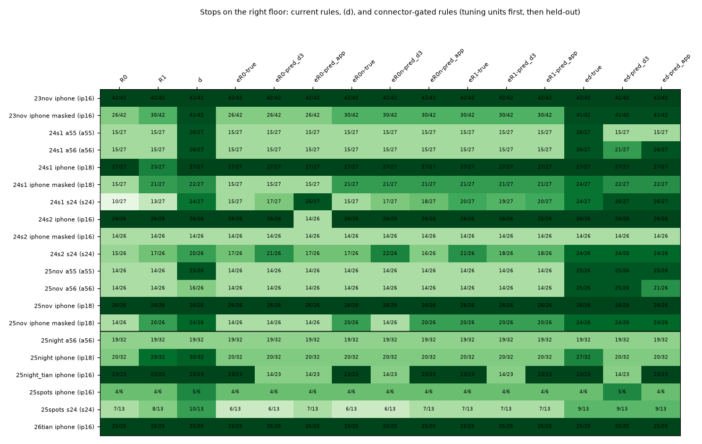
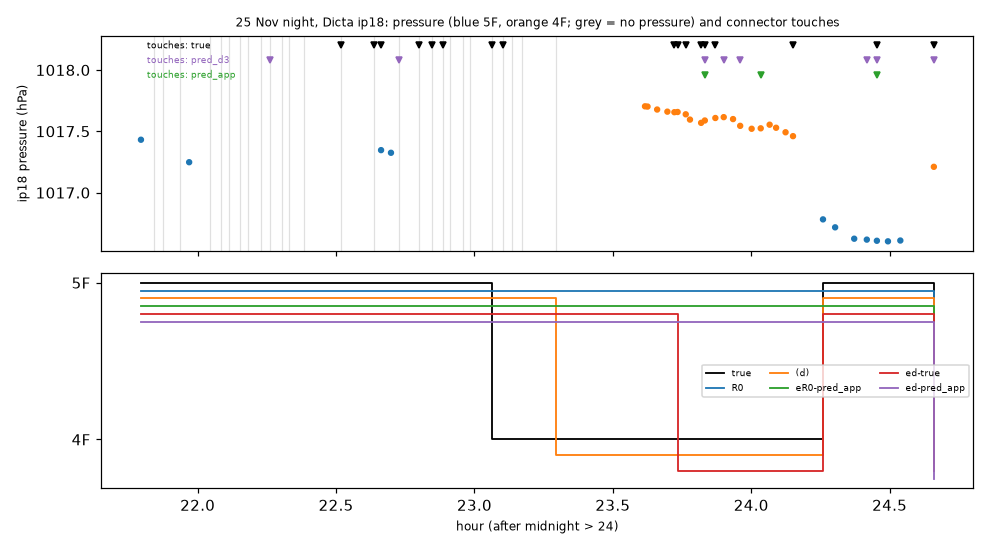

# Floor rules when the barometer is missing (offline study, PROCESS-LOG entry 74)

Internal team notes, not report text. Nothing here is wired into the upload app. Section 7 (entry 76) adds the
connector-gated rules ("entry/exit points").

**Question.** The upload app's floor tracker is right at every stop where the iPhone logged pressure, but on the
25-Nov night run it showed 5F at 12 of Dicta's 4F stops (20/32): her iPhone logged no pressure from 22:43 to 23:17,
which is when the group went down, and Chris's a56 never logs pressure. Which fallback rule would have helped,
scored honestly?

**Method.** The candidate rules, their parameter grids, the split and the decision rule were written in
[`PREREGISTRATION.md`](PREREGISTRATION.md) and committed (a884c97) before any candidate was run. Parameters were
chosen on the tuning sessions (23 Nov, 24 s1, 24 s2, 25 Nov) only and frozen (`out/params.json`); the held-out
sessions (25 night, 25 night Tian, 26 Tian, 25 spots) were scored once.

Run (a few seconds; uses the day-3 feature cache, built by `day3/data.py` on first use):

```sh
python phase2/new/floor/baseline.py      # reproduces the two current rules -> out/baseline.json
python phase2/new/floor/candidates.py    # tune, freeze, score, figures -> out/*.json, out/table.csv, out/fig_*.png
```

## 1. The current rules, reproduced from their own code

- **R0, upload app** (`upload/walksense.py` `Session.track_floor`): every recording (stop or walk) gives two
  readings, the median pressure of its first and last 3 s. Each reading is compared with the median of the last 6
  readings on the current floor; more than 0.40 hPa higher = moved down to 4F, more than 0.40 hPa lower = up to 5F
  (then the reference starts again). If more than 15 min passed since the end of the last recording **with
  pressure**, the reference is emptied and the floor is kept. A recording without pressure keeps the floor.
- **R1, day-3 step tracking** (`day3/data.py` `track_floor`, threshold from `day3/evaluate.py` `floor_eval`): stop
  medians only; the floor changes when two consecutive stops with pressure differ by more than half the median floor
  step of the other sessions (0.292 to 0.307 hPa for the iPhone); a stop without pressure keeps the floor.
- `out/baseline.json` `all_match` = true: R0 gives 27/27, 26/26, 26/26, 20/32, 23/23, 25/25 exactly as
  `upload/out/eval.json`, R1 gives every `day3/out/results.json` `floor` number (e.g. 24s1 23/27, 25night 29/32).

Why R0 fails on 25 night (`out/scores.json`, `fig_25night_timeline.png`): the last reading before the dropout is
the 22:41 walk on 5F; the next one is the 23:36 walk on 4F, so the rule sees a gap of about 55 min (not the 19 min
between recordings), keeps 5F and re-anchors on 4F pressure. Even without the reset it would not move: c1 with the
gap rule switched off ("never") also gives 20/32, because the pressure had fallen with the weather and the 4F
reading was less than 0.40 hPa above the 5F reference. R1 compares stop medians with a lower threshold (0.292 hPa)
and catches the step at 23:37, so it misses only the 3 stops without pressure.

## 2. Candidates (as pre-registered)

| id | rule | frozen parameters (`out/params.json`) |
|---|---|---|
| a | magnetic floor vote only: kNN (x/y/z of the 5 s stop windows) trained on the other sessions' stops of the same phone model, floor = argmax of the mean probability | k = 5 |
| b | transition detection from motion | **not testable**, see below |
| c1 | R0 with the gap T tuned | T = never (tuning: 202 stops right with "never", 196 with 60 min, 190 with 5 to 30 min; `out/tuning.json`) |
| c2 | R0 with a drift-extrapolated reference (30-min slope, clamped to 1 hPa/h), never reset | fixed, nothing tuned |
| d | R0 when pressure is present; the magnetic vote is consulted at stops without pressure and at the first M stops after a gap > 15 min; H confident votes in a row for the other floor switch it | k = 15, P = 0.7, H = 2, M = 3 (359 of 401 tuning stops) |

**(b) is not testable with this data** (`out/motion_check.json`, `fig_motion_check.png`): in all 301 iPhone
recordings with pressure, the largest change between the start and the end of one recording is 0.19 hPa, below one
floor step. The escalator, lift and stair rides were never inside a recording (collectors stopped recording between
places), so there is no labelled transition to train or score an accelerometer/gyroscope detector on. (The S24
shows changes up to 6.2 hPa inside recordings, which is its noise, not a floor change.)

## 3. Scores: stops on the right floor (walks in brackets)

From `out/scores.json` / `out/table.csv`. "masked" = a tuning iPhone unit with pressure deleted for every recording
within 20 min of its floor change (simulates Dicta's dropout). a55 and a56 have no barometer: R0, R1, c1 and c2
just keep the start floor there. (d) treats the S24 barometer as absent (pre-registered, it is too noisy).

| unit | handset | pressure recs | R0 | R1 | c1 | c2 | a | d |
|---|---|---|---|---|---|---|---|---|
| 23nov iphone (tuning) | ip16 | 42/42 | 42/42 (0/0) | 42/42 (0/0) | 42/42 (0/0) | 42/42 (0/0) | 36/42 (0/0) | 42/42 (0/0) |
| 23nov iphone masked (tuning) | ip16 | 23/42 | 26/42 (0/0) | 30/42 (0/0) | 30/42 (0/0) | 30/42 (0/0) | 36/42 (0/0) | 41/42 (0/0) |
| 24s1 a55 (tuning) | a55 | 0/55 | 15/27 (15/28) | 15/27 (15/28) | 15/27 (15/28) | 15/27 (15/28) | 21/27 (23/28) | 26/27 (28/28) |
| 24s1 a56 (tuning) | a56 | 0/55 | 15/27 (15/28) | 15/27 (15/28) | 15/27 (15/28) | 15/27 (15/28) | 23/27 (24/28) | 26/27 (27/28) |
| 24s1 iphone (tuning) | ip18 | 55/55 | 27/27 (28/28) | 23/27 (25/28) | 23/27 (24/28) | 23/27 (24/28) | 19/27 (19/28) | 27/27 (28/28) |
| 24s1 iphone masked (tuning) | ip18 | 35/55 | 15/27 (15/28) | 21/27 (22/28) | 21/27 (22/28) | 21/27 (22/28) | 19/27 (19/28) | 22/27 (23/28) |
| 24s1 s24 (tuning) | s24 | 55/55 | 10/27 (13/28) | 13/27 (14/28) | 10/27 (12/28) | 10/27 (12/28) | 16/27 (17/28) | 24/27 (24/28) |
| 24s2 iphone (tuning) | ip16 | 54/54 | 26/26 (28/28) | 26/26 (28/28) | 26/26 (28/28) | 26/26 (28/28) | 17/26 (19/28) | 26/26 (28/28) |
| 24s2 iphone masked (tuning) | ip16 | 31/54 | 14/26 (15/28) | 14/26 (15/28) | 14/26 (15/28) | 14/26 (15/28) | 17/26 (19/28) | 14/26 (15/28) |
| 24s2 s24 (tuning) | s24 | 54/54 | 15/26 (14/28) | 17/26 (18/28) | 15/26 (14/28) | 15/26 (14/28) | 16/26 (15/28) | 20/26 (22/28) |
| 25nov a55 (tuning) | a55 | 0/54 | 14/26 (15/28) | 14/26 (15/28) | 14/26 (15/28) | 14/26 (15/28) | 23/26 (24/28) | 25/26 (27/28) |
| 25nov a56 (tuning) | a56 | 0/53 | 14/26 (15/27) | 14/26 (15/27) | 14/26 (15/27) | 14/26 (15/27) | 16/26 (16/27) | 16/26 (15/27) |
| 25nov iphone (tuning) | ip18 | 54/54 | 26/26 (28/28) | 26/26 (28/28) | 26/26 (28/28) | 26/26 (28/28) | 24/26 (25/28) | 26/26 (28/28) |
| 25nov iphone masked (tuning) | ip18 | 33/54 | 14/26 (15/28) | 20/26 (22/28) | 20/26 (22/28) | 20/26 (22/28) | 24/26 (25/28) | 24/26 (26/28) |
| **25night a56** | a56 | 0/58 | 19/32 (13/26) | 19/32 (13/26) | 19/32 (13/26) | 19/32 (13/26) | 17/32 (12/26) | 19/32 (13/26) |
| **25night iphone** | ip18 | 32/59 | 20/32 (14/27) | 29/32 (24/27) | 20/32 (14/27) | 28/32 (22/27) | 25/32 (22/27) | **30/32 (25/27)** |
| 25night_tian iphone | ip16 | 46/46 | 23/23 (23/23) | 23/23 (23/23) | 23/23 (23/23) | 23/23 (23/23) | 21/23 (20/23) | 23/23 (23/23) |
| 25spots iphone | ip16 | 8/8 | 4/6 (0/2) | 4/6 (0/2) | 4/6 (0/2) | 4/6 (0/2) | 5/6 (2/2) | 5/6 (2/2) |
| 25spots s24 | s24 | 13/13 | 7/13 (0/0) | 8/13 (0/0) | 7/13 (0/0) | 7/13 (0/0) | 9/13 (0/0) | 10/13 (0/0) |
| 26tian iphone | ip16 | 52/52 | 25/25 (27/27) | 25/25 (27/27) | 25/25 (27/27) | 25/25 (27/27) | 24/25 (26/27) | 25/25 (27/27) |

Tuning rows for (a) and (d) are leave-one-session-out inside the tuning sessions (the vote never sees its own
session), but their parameters were chosen on these rows, so they are optimistic. Held-out rows are the honest ones.

## 4. Where each rule fails (wrong stops in `out/scores.json`)

- **R0**: any floor change without pressure, and a long gap at a floor change (25 night 12 stops, 23:03 to 24:05);
  25 spots iPhone: the two 5F spots at 20:22-20:23 after a 2.5 h gap with the floor still at 4F.
- **R1**: weather across a break: 24 s1 18:12 to 18:22 (4 stops, +0.833 hPa during the break, entry 30); stops
  without pressure (25 night 23:03, 23:08, 23:17). Its 25-night success after the 55-min gap is the same bet that
  failed on 24 s1: a pressure step after a long gap is read as a floor change.
- **c1**: tuning picked "never reset", because in the masked runs the floor change is still visible after the
  dropout. It then loses the 4 weather stops of 24 s1 (like R1) and gains nothing on 25 night (the step was below
  0.40 hPa).
- **c2**: the 30-min slope does not follow the 24 s1 weather (same 4 stops wrong); on 25 night it moves to 4F too
  early (22:43 to 22:59, 4 stops), extrapolating the falling evening pressure. Its 28/32 is partly luck.
- **(a)**: the magnetic vote alone is wrong at 1 to 9 stops per iPhone unit even with pressure available (e.g. 24 s2
  ip16 17/26, 26 Tian 24/25); it loses 4 stops that R0 gets right on the complete-pressure held-out units
  (`out/decision.json`).
- **(d)**: 25 night ip18 misses 23:03 and 23:08: the vote (`out/scores.json` `votes_k_d`) said 4F at 22:59 (wrong, still on 5F), 5F at 23:03
  (wrong) and 4F at 23:08 and 23:17, so H = 2 switches at 23:17. With H = 1 the 22:59 vote would have switched too
  early. 24 s2 masked: the ip16 votes at the 4F stops were not confident twice in a row, so no switch (14/26).
- **a56 on 25 night, every rule**: 19/32 at best (= never leaving 5F). The magnetic vote (`votes_k_d`) says 5F at 11 of its 13
  4F stops (the night magnetometer reads about 85 uT off, entry 72), so (d) never switches and (a) is worse (17/32).

## 5. Recommendation (decision rule from the pre-registration, `out/decision.json`)

- **iPhone: (d) passes** (and so do R1 and c2): it loses no stop that R0 gets right on 25 night Tian, 26 Tian and
  25 spots, and gains 10 stops on 25 night ip18 (20 -> 30/32). R1 (+9) and c2 (+8) also pass, but both lose the 4
  weather stops of 24 s1 that R0 and (d) keep. **(d) with k = 15, P = 0.7, H = 2, M = 3** is the candidate to
  propose for the app: it is R0 unchanged whenever pressure is present and continuous, and only asks the magnetometer
  when pressure is missing or right after a long gap.
- **Phones without a barometer (a55, a56; S24 treated as absent): no rule passes.** (d) is far above "keep the start
  floor" on the tuning sessions (137 vs 83 of 159 stops) and on 25 spots S24 (10 vs 7 of 13), but the only held-out
  no-barometer unit, Chris's a56 on 25 night, is unchanged (19 vs 19 of 32) because its magnetometer is off.
  So the gain for no-barometer phones is not shown on held-out data; it needs a held-out session with a healthy
  Android magnetometer.
- (b) cannot be decided: record one take across a floor change (start before stepping on the escalator, stop after)
  if the team wants it tested.

## 6. Limits

- Small n: one held-out unit has a real dropout (25 night ip18); the masked runs are simulations on tuning data.
- The vote uses the day-3 5 s windows with no trimming, not the app's 2 s trimmed windows.
- Every rule starts on the true first floor, as `walksense.py evaluate` does.
- 23 Nov has stops only (no walk pressure), so R0 sees one reading per stop there.

## 7. Connector-gated rules: the floor may only switch at a lift/escalator landing (PROCESS-LOG entry 76)

**Idea (user, 26 Nov).** A floor change can only happen through a connector (lift/stairs core, or the one-way
escalators: down only 5F -> 4F, up only 4F -> 5F), so let the floor switch only right after the walker was at a
connector landing, in a direction that connector allows, and ignore floor evidence everywhere else.

**Method.** [`PREREGISTRATION_landing.md`](PREREGISTRATION_landing.md), committed (0e8ef6a) before any gated rule was
run; it lists what had been looked at first. Same recordings, units, split, masked copies and scoring as sections 1 to
5. A *touch* = a recording at a connector (kind from the name, floor-agnostic: lift / down / up); the gate is open
at recording i towards the other floor if a touch j <= i of a kind that allows that direction started at most T
minutes before i (the arrival landing itself counts). Gated rules: eR0 (R0, a jump only switches with the gate open,
otherwise it joins the reference), eR0n (eR0 without the 15-min reset, threshold theta), eR1 (R1 gated), ed ((d)
with both its pressure and vote switches gated). Gate sources: `true` (true place names, stops and walk endpoints;
upper bound), `pred_d3` (day-3 leave-one-session-out fused kNN top-1), `pred_app` (the upload app's own place model,
top-1 among the places of the floor the tracker shows before the recording: what the app could do live; 23 Nov is
not an app session, so `pred_app` = ungated there). With the gate always open each gated rule reproduces R0, R1 and
(d) exactly (asserted in `landing.py`).

```sh
python phase2/new/floor/landing.py   # ~10 s with out/landing_pred_app.json cached, ~2 min without
```

Frozen on the tuning sessions (`out/landing_params.json`, grid in `out/landing_tuning.json`): T = 10 min for
eR0/eR0n/ed with the true gate, 20 min for eR1-true; 20 / 20 / 30 / 30 min for eR0 / eR0n / eR1 / ed with
`pred_d3`; 20 / 45 / 60 / 45 min with `pred_app`; theta = 0.30 for eR0n-pred_d3 and eR0n-pred_app, 0.40 otherwise.

### 7.1 Scores: stops on the right floor (`out/landing_table.csv`, walks there too; `p_` = `pred_`)

| unit | handset | R0 | R1 | d | eR0-true | eR0-p_d3 | eR0-p_app | eR0n-true | eR0n-p_d3 | eR0n-p_app | eR1-true | eR1-p_d3 | eR1-p_app | ed-true | ed-p_d3 | ed-p_app |
|---|---|---|---|---|---|---|---|---|---|---|---|---|---|---|---|---|
| 23nov iphone (tuning) | ip16 | 42/42 | 42/42 | 42/42 | 42/42 | 42/42 | 42/42 | 42/42 | 42/42 | 42/42 | 42/42 | 42/42 | 42/42 | 42/42 | 42/42 | 42/42 |
| 23nov iphone masked (tuning) | ip16 | 26/42 | 30/42 | 41/42 | 26/42 | 26/42 | 26/42 | 30/42 | 30/42 | 30/42 | 30/42 | 30/42 | 30/42 | 41/42 | 41/42 | 41/42 |
| 24s1 a55 (tuning) | a55 | 15/27 | 15/27 | 26/27 | 15/27 | 15/27 | 15/27 | 15/27 | 15/27 | 15/27 | 15/27 | 15/27 | 15/27 | 26/27 | 15/27 | 15/27 |
| 24s1 a56 (tuning) | a56 | 15/27 | 15/27 | 26/27 | 15/27 | 15/27 | 15/27 | 15/27 | 15/27 | 15/27 | 15/27 | 15/27 | 15/27 | 26/27 | 21/27 | 26/27 |
| 24s1 iphone (tuning) | ip18 | 27/27 | 23/27 | 27/27 | 27/27 | 27/27 | 27/27 | 27/27 | 27/27 | 27/27 | 27/27 | 27/27 | 27/27 | 27/27 | 27/27 | 27/27 |
| 24s1 iphone masked (tuning) | ip18 | 15/27 | 21/27 | 22/27 | 15/27 | 15/27 | 15/27 | 21/27 | 21/27 | 21/27 | 21/27 | 21/27 | 21/27 | 24/27 | 22/27 | 22/27 |
| 24s1 s24 (tuning) | s24 | 10/27 | 13/27 | 24/27 | 15/27 | 17/27 | 26/27 | 15/27 | 17/27 | 18/27 | 20/27 | 19/27 | 20/27 | 24/27 | 26/27 | 26/27 |
| 24s2 iphone (tuning) | ip16 | 26/26 | 26/26 | 26/26 | 26/26 | 26/26 | 14/26 | 26/26 | 26/26 | 26/26 | 26/26 | 26/26 | 26/26 | 26/26 | 26/26 | 26/26 |
| 24s2 iphone masked (tuning) | ip16 | 14/26 | 14/26 | 14/26 | 14/26 | 14/26 | 14/26 | 14/26 | 14/26 | 14/26 | 14/26 | 14/26 | 14/26 | 14/26 | 14/26 | 14/26 |
| 24s2 s24 (tuning) | s24 | 15/26 | 17/26 | 20/26 | 17/26 | 21/26 | 17/26 | 17/26 | 22/26 | 16/26 | 21/26 | 18/26 | 18/26 | 24/26 | 24/26 | 24/26 |
| 25nov a55 (tuning) | a55 | 14/26 | 14/26 | 25/26 | 14/26 | 14/26 | 14/26 | 14/26 | 14/26 | 14/26 | 14/26 | 14/26 | 14/26 | 25/26 | 25/26 | 25/26 |
| 25nov a56 (tuning) | a56 | 14/26 | 14/26 | 16/26 | 14/26 | 14/26 | 14/26 | 14/26 | 14/26 | 14/26 | 14/26 | 14/26 | 14/26 | 25/26 | 25/26 | 21/26 |
| 25nov iphone (tuning) | ip18 | 26/26 | 26/26 | 26/26 | 26/26 | 26/26 | 26/26 | 26/26 | 26/26 | 26/26 | 26/26 | 26/26 | 26/26 | 26/26 | 26/26 | 26/26 |
| 25nov iphone masked (tuning) | ip18 | 14/26 | 20/26 | 24/26 | 14/26 | 14/26 | 14/26 | 20/26 | 14/26 | 20/26 | 20/26 | 20/26 | 20/26 | 24/26 | 24/26 | 24/26 |
| **25night a56** | a56 | 19/32 | 19/32 | 19/32 | 19/32 | 19/32 | 19/32 | 19/32 | 19/32 | 19/32 | 19/32 | 19/32 | 19/32 | 19/32 | 19/32 | 19/32 |
| **25night iphone** | ip18 | 20/32 | 29/32 | 30/32 | 20/32 | 20/32 | 20/32 | 20/32 | 20/32 | 20/32 | 20/32 | 20/32 | 20/32 | 27/32 | 20/32 | 20/32 |
| **25night_tian iphone** | ip16 | 23/23 | 23/23 | 23/23 | 23/23 | 14/23 | 14/23 | 23/23 | 14/23 | 23/23 | 23/23 | 14/23 | 23/23 | 23/23 | 14/23 | 23/23 |
| **25spots iphone** | ip16 | 4/6 | 4/6 | 5/6 | 4/6 | 4/6 | 4/6 | 4/6 | 4/6 | 4/6 | 4/6 | 4/6 | 4/6 | 4/6 | 5/6 | 4/6 |
| **25spots s24** | s24 | 7/13 | 8/13 | 10/13 | 6/13 | 6/13 | 7/13 | 6/13 | 6/13 | 7/13 | 7/13 | 7/13 | 7/13 | 9/13 | 9/13 | 9/13 |
| **26tian iphone** | ip16 | 25/25 | 25/25 | 25/25 | 25/25 | 25/25 | 25/25 | 25/25 | 25/25 | 25/25 | 25/25 | 25/25 | 25/25 | 25/25 | 25/25 | 25/25 |




### 7.2 Decision (`out/landing_decision.json`)

- **No `pred_app` (or `pred_d3`) candidate passes.** Every one gains 0 stops on 25night ip18 (20/32 like R0). eR0-,
  eR0n-, eR1- and ed-pred_d3 and eR0-pred_app also lose 9 stops R0 gets right on 25night_tian (14/23 instead of
  23/23). eR0n-pred_app, eR1-pred_app and ed-pred_app lose nothing on the complete-pressure units but gain nothing.
- **Only ed-true passes** the iPhone rule (+7 on 25night ip18: 27/32, no loss on 25night_tian, 26tian, 25spots ip16),
  but it is the upper bound with the true places, it is 3 stops below ungated (d) (30/32), and it loses 4 stops R0
  gets right on 25spots s24. The pre-registration says true-gate rows never justify an app change.
- **Phones without a barometer: none passes.** On held-out 25night a56 every ed variant is 19 vs 19 of 32 (the a56
  night magnetometer, section 4). Tuning a55 + a56 + s24: ed-true 150, ed-pred_app 137, ed-pred_d3 136, vs (d) 137
  and "start floor kept" 83 of 159.
- **So the app was not changed** (decision rule 2: nothing eligible passes).

### 7.3 Why the gate does not help here

- **A gate can only remove switches.** On the held-out iPhone units with complete pressure R0 makes no false switch
  to remove; its only misses there (25spots ip16 20:22 and 20:23, after a 150-min gap) are a switch that did not
  happen, which a gate cannot add. So on these units a gate can only lose.
- **A missed gate costs the rest of the floor.** If the connector is not recognised, the real jump joins the reference
  and the floor never switches. 25night_tian with `pred_d3`: the 22:18 lift stop and the 22:29 4F lift landing were
  not named as connectors, so 9 stops stay on 5F; 24 s2 ip16 with eR0-pred_app: 14/26 (tuning). Connector
  recognition at top-1 (`out/landing_gate_stats.json` `connector_recognition`, all stops, all phones): the day-3 fused
  kNN names the right connector kind at 37 of 101 connector stops and names a connector at 57 of 310 other stops; the
  app model 32 of 88 and 44 of 281.
- **The gate opens for 20 of 22 labelled changes with the true places, but for only 13 of 22 (`pred_d3`) and 11 of 21
  (`pred_app`)** (`out/transitions.json`, at the frozen eR0 T). The app model never sees the arrival landing as a
  connector (0 of 21), because it is asked among the places of the floor it still believes it is on.
- **The 25-night dropout is not a gating problem.** Dicta's pressure comes back at 23:36, 33.2 min after the 23:03
  change, with a step of 0.379 hPa from the last 5F reading at 22:41 (below 0.40); no frozen T keeps the gate open
  that long with the true touches (T = 10 min), so all pressure-only gated rules stay at 20/32. ed-true (T = 10 min)
  ignores (d)'s confident 4F votes at 23:17 and 23:37 (gate closed) and switches only at 23:44, after the 23:43 walk
  to the 4F down escalator re-opens the gate (wrong stops 23:03, 23:08, 23:17, 23:37, 23:41; (d): 23:03, 23:08).
- **The gate is open often anyway:** with the true places 243 touches, of which 205 are not followed by a floor change
  within T (people pass the lift and escalators all the time), so it filters little.
- **What it does fix:** R1's weather switch after the 24 s1 break. eR1 with any of the three gates gives 24s1 ip18
  27/27 (R1 23/27), because the last touch before the 79-min break (the 16:51 walk between the 5F escalators) is
  too old. R0 already avoids that case with its 15-min reset.

### 7.4 Entry/exit points in the recordings (step 2 of the request, `out/transitions.json`)

- **No recording with pressure spans a floor change.** 61 iPhone walks start or end at a connector landing (including
  the 4F walks named after the 5F lift, `lift_stairs5->...`, and the 4F `esca_down->esca_up`); the largest pressure
  change inside any of them is 0.041 hPa, none above 0.40. Every change happens between two recordings.
- **Pressure across consecutive recordings brackets every iPhone change that has pressure on both sides** (last
  reading before -> first after): 23nov +0.684, 24s1 +0.424, 24s2 +0.565, 25nov +0.651, 25night_tian +0.575, 26tian
  +0.625, 25night 24:15 -0.67 and 24:39 +0.614, 25spots 17:49 +0.591 hPa; the two exceptions are the long gaps
  (25night 23:03: +0.379 over 55 min, 25spots 20:22: +0.291 after a 150-min gap).
- **The only recording that spans a change is the 23-Nov stairs walk ACC23** ("exit 5 stairs -> exit 5 stairs bawah",
  18:34:17 to 18:34:47, 30 s). It has no barometer file; the stops either side bracket it: BM26 (5F lift/stairs)
  1015.014 hPa, BM27 (4F) 1015.698 hPa, +0.684 hPa. One example, so a motion detector for the ride still cannot be
  trained or scored.
- On the route the team walked, the departure landing is usually not the recording right before the change: on the
  24-Nov-style route the last 5F lift touch (the lift stop or the walk leaving it) is 6.0 to 12.7 min before the
  change (23 Nov: 3.0 min), then the walker comes back to the lift unrecorded; the first recording on the new floor is
  a landing at 18 of 22 changes (true places).

### 7.5 Limits

- The fused kNN predictions use the barometer group too, and were left as computed in the masked copies.
- `pred_app` is trained on the other app sessions of the same phone model; 23 Nov has no `pred_app` (ungated there).
- One real dropout (25 night ip18) and one held-out no-barometer unit with a faulty magnetometer, as in section 6.
